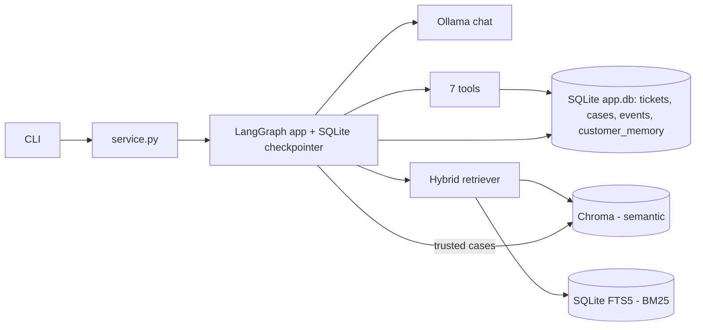
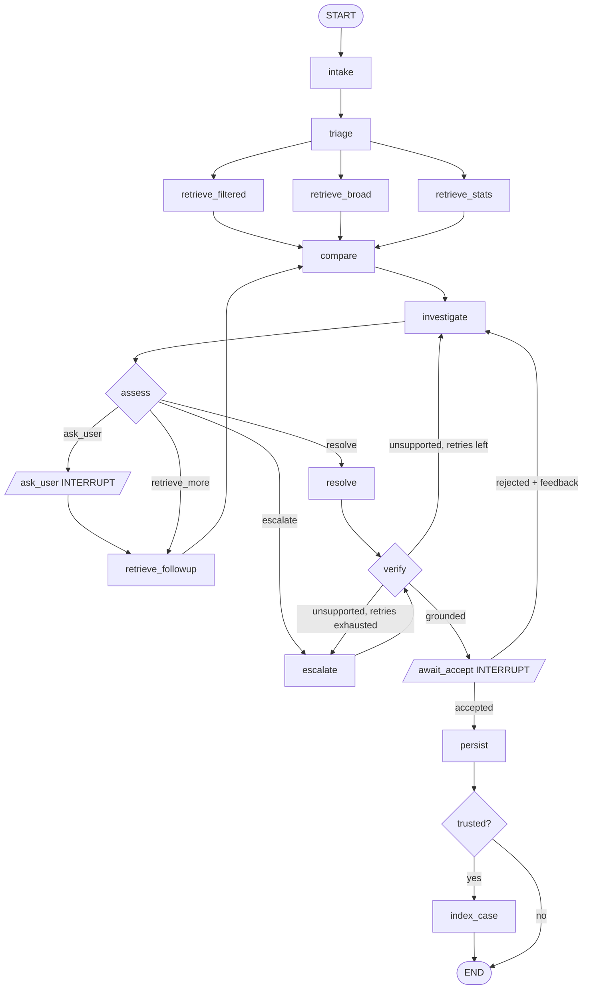

# Autonomous Support Investigation Agent

A locally runnable, **LangGraph**-based support agent. It investigates new tickets using ~24K historical
English tickets (Hugging Face `Tobi-Bueck/customer-support-tickets`, the *only* knowledge source),
reasons across several cases, asks the user for clarification when needed (interrupt / resume), and
**keeps growing its trusted case knowledge** as cases are resolved.

It is a **multi-turn** agent: within one ticket it can pause to ask the user clarification questions
(max 2) and then ask for acceptance, re-investigating on feedback (`resume` on the same `thread_id`); across
tickets it remembers each customer (`--customer-id`) via long-term memory. Use `agent chat` for an interactive session, or `agent ticket` / `agent resume` for scriptable single steps.
It is a command-line tool, not an open-ended chatbot: each ticket is one investigation, and the agent
only asks questions that it needs to resolve that ticket.

Everything runs locally and costs nothing: **Ollama** (chat + embeddings), **ChromaDB**, **SQLite**.
No API keys, no cloud calls at runtime. Design rationale and the options considered for every
technology choice are in [`docs/DECISIONS.md`](docs/DECISIONS.md); the original plan is
[`docs/PLAN.md`](docs/PLAN.md).

---

## Requirements
| | |
|---|---|
| OS | macOS or Linux (developed on macOS / Apple Silicon). Windows: use WSL2 |
| Hardware | 16 GB RAM recommended (qwen3:8b needs ~6 GB); Apple Silicon / GPU makes it much faster |
| Disk | ~10 GB (models ~5.5 GB, dataset + indexes ~0.4 GB) |
| Software | [Ollama](https://ollama.com/download), [uv](https://docs.astral.sh/uv/getting-started/installation/) (it installs Python 3.12 for you), git |
| Network | Only for the one-time downloads (models, dataset, Python packages). Afterwards it runs offline |
| Accounts / keys | **None** |

## Quick start (from zero)
Run the commands one per line, exactly as written (do not paste the `#` comments into the shell).

**0. Install the prerequisites** (skip any you already have; check with `git --version`, `uv --version`, `ollama --version`)

macOS (needs [Homebrew](https://brew.sh); if `brew --version` fails, install it first from that site):
```bash
brew install git uv
brew install --cask ollama-app
open -a Ollama
```
Linux (Debian/Ubuntu shown):
```bash
sudo apt-get update && sudo apt-get install -y git curl
curl -LsSf https://astral.sh/uv/install.sh | sh
curl -fsSL https://ollama.com/install.sh | sh
```
Open a **new terminal** afterwards so `uv` is on your PATH. Windows: install [WSL2](https://learn.microsoft.com/windows/wsl/install)
(Ubuntu) and follow the Linux commands inside it. Python is **not** needed - `uv` downloads Python 3.12 itself.

**1. Get the code and install dependencies**
```bash
git clone https://github.com/ranjithrece/support-investigation-agent.git && cd support-investigation-agent
uv sync
```

**2. Make sure Ollama is running, then pull the two local models** (~5.5 GB, once)
On macOS the Ollama app (started in step 0) runs it; on Linux the installer starts a service. If
`ollama list` says it cannot connect, run `ollama serve` in a separate terminal and keep it open.
```bash
ollama pull qwen3:8b
ollama pull nomic-embed-text
```
Check with `ollama list` - both models must be listed.

**3. Build the knowledge base** (once, ~15 min on Apple Silicon; resumable if interrupted)
```bash
uv run agent download
uv run agent ingest
```
`download` fetches two public CSVs from Hugging Face (no token). `ingest` loads ~23.7K English tickets into
SQLite + FTS5, embeds them with `nomic-embed-text` into Chroma, and holds out 200 for evaluation.
Expected final line: `{'tickets': 23742, 'new_rows': ..., 'embedded': 23542}`.
For a quick trial first (~15 s), use `uv run agent ingest --limit 500`; the later full `ingest` simply adds the rest.

**4. Verify the install (no Ollama needed)**
```bash
uv run pytest
```
Expected: `37 passed`.

**5a. Chat with the agent (multi-turn, recommended)** - one prompt, no thread ids to copy
```bash
uv run agent chat --customer-id acme
```
Type a problem description. If the agent needs more information it asks, and you simply type the answer at the
next prompt (up to 2 questions). It then shows its proposed resolution: type `accept`, or type feedback to make
it re-investigate. After that you can describe another problem in the same session - the agent remembers the
customer between tickets. `/new` abandons the current ticket, `/exit` quits (an open ticket can still be
continued later with `agent resume`).

**5b. Or use single commands** (scriptable; each ticket takes ~1-2 minutes on `qwen3:8b`)
```bash
uv run agent ticket --customer-id acme --subject "VPN keeps dropping" --body "Our VPN disconnects every few minutes and the shared drive is lost."
```
The agent either finishes with a result, or **pauses** and prints a question plus a ready-to-copy command like
`agent resume --thread-id T-1a2b3c4d --answer "..."`. Use the real id it printed:
```bash
uv run agent resume --thread-id T-1a2b3c4d --answer "All offices, started after a firmware update"
uv run agent resume --thread-id T-1a2b3c4d --answer accept
```
Answer clarification questions in plain text. At the final "Accept this outcome?" prompt, type `accept` to
confirm (the case is then stored and, if trusted, added to the searchable knowledge) or type feedback to
reject it and make the agent re-investigate. Add `--auto-accept` to `ticket` to skip that prompt.

**6. Inspect what happened**
```bash
uv run agent show --customer-id acme
uv run agent show --case-id C-20260101-ABC123
```
`--customer-id` shows case history plus long-term memory; `--case-id` shows the full event trail.

**7. Run the demo and the evaluation** (both are slow; they call the real model many times)
```bash
uv run python scripts/demo.py --scenario all
uv run agent eval --limit 10
```
The demo runs the 4 required paths (~10 min; a captured transcript is in `docs/DEMO_OUTPUT.md`). Run one with
`--scenario normal|clarify|memory|growth`. `eval` prints a score table and writes `evals/results/latest.json`
(`--limit 3` for a quick run). Demo and eval **write test cases into `data/`**; to start clean, delete the
`data/` folder and re-run `download` + `ingest`.

### Configuration (optional)
Defaults work. To change anything: `cp .env.example .env` and edit, e.g. `CHAT_MODEL=gpt-oss:20b`
(larger, slower) or `OLLAMA_BASE_URL` for a non-default Ollama address.

### Troubleshooting
| Message / symptom | Fix |
|---|---|
| `Setup problem: Cannot reach Ollama` | Start Ollama (`ollama serve` or the app); check `curl http://127.0.0.1:11434/api/tags` |
| `Setup problem: Missing Ollama model(s)` | Run the `ollama pull ...` command it prints |
| `Setup problem: No ticket knowledge base found` | Run `uv run agent download` then `uv run agent ingest` |
| `zsh: no such file or directory: thread_id` / `parse error near '<'` | You pasted a `<placeholder>`; use the real `T-...` id |
| `Got unexpected extra argument (# ...)` | You pasted a `#` comment; remove it |
| `No such option: --customer` | The flag is `--customer-id` |
| `ingest` was interrupted | Re-run `uv run agent ingest`; it resumes and skips embedded tickets |
| Very slow responses | Normal for a local 8B model on CPU. A GPU / Apple Silicon is ~5-10x faster |
| `uv` cannot find Python 3.12 | `uv python install 3.12` (the project pins 3.12) |

---

## Architecture



| Layer | Code |
|---|---|
| Interface | `cli.py`, `service.py`, `render.py` |
| Orchestration | `graph/` (state, nodes, prompts, builder with routers) |
| Reasoning | `llm.py`, `tools/registry.py`, `skills_loader.py` + `skills/*/SKILL.md` |
| Knowledge/memory | `retrieval/` (hybrid, compare, index), `memory/long_term.py`, `storage/` |
| Quality | `evals/runner.py`, `scoring.py`, `tests/` |

## Graph design

Pattern: a **model-driven ReAct investigator embedded in an evaluator-optimizer graph with
human-in-the-loop**. The model decides *which tools to call and when* (inside `investigate`); the graph owns
the lifecycle, routing, bounded loops, verification, memory writes and indexing - things that must be
reliable with a small local model. Alternatives are discussed in `docs/DECISIONS.md` (D1).



* **16 nodes, 4 conditional routers** (`assess`, `verify`, `await_accept`, `persist`).
* **Loops:** clarification (`ask_user -> retrieve_followup -> compare -> investigate -> assess`),
  hypothesis-driven re-retrieval, verify -> re-investigate, user-rejection -> re-investigate. All bounded
  (`MAX_INVESTIGATION_ROUNDS`, `MAX_VERIFY_RETRIES`, max 2 clarification questions, max 2 rejections).
* **Interrupt / resume:** `ask_user` and `await_accept` use `langgraph.types.interrupt`; resume with
  `Command(resume=...)` on the same `thread_id`. State lives in a **SQLite checkpointer**, so you can
  resume from a different process (tested: `test_clarification_interrupt_resume_across_app_instances`).
* **Parallel execution:** after `triage`, three retrieval branches (filtered semantic+BM25, broad
  semantic+BM25, queue/tag statistics) run in one super-step and merge via the `evidence` reducer
  (`merge_evidence`: union by ticket ID, best similarity).
* **Guardrails around LLM routing** (`nodes.assess`): the LLM proposes a route; deterministic rules veto
  unnecessary questions (evidence agreement is `high`), repeated/rephrased questions, and more than two
  clarifications - the PDF asks to clarify only when information is insufficient or evidence conflicts.

### State (`graph/state.py`)
Identity (`case_id`, `customer_id`, `thread_id`), ticket, `messages` (short-term, `add_messages`),
`clarifications`, loaded `customer_memory`/`customer_history`, `classification`, `selected_skills`,
`evidence` (reducer), `evidence_assessment`, `hypothesis`, `findings`, control counters/route, `draft`,
`verification`, final `result`.

## Case lifecycle and growing knowledge
`intake` inserts the ticket as an **OPEN** case immediately (also `AWAITING_USER`, `PROPOSED`, then
`RESOLVED`/`ESCALATED`, then `INDEXED`). Open/previous cases are visible to `get_customer_history` as customer
history but are **not** in the trusted vector index. After the user accepts, `persist` stores
classification + resolution + analysis + evidence + confidence, and `index_case` adds the case to
SQLite/FTS and Chroma (`source=live`) **only if trusted**:

`accepted AND not escalated AND verifier-grounded AND confidence >= 0.7`

This stops hallucinated or unaccepted answers from compounding in the knowledge base.

## RAG approach (`retrieval/`)
* **Unit:** one ticket = one document; embedded text is `subject + body` (the *problem*), the answer is stored
  and shown after retrieval so matching is by problem, not answer wording. nomic-embed-text with
  `search_document:` / `search_query:` prefixes.
* **Metadata:** queue, type, priority, tags, source (`hist`/`live`). Metadata is used as Chroma `where`
  filters and SQL filters; if a filtered search yields < 3 hits, filters are relaxed step by step
  (priority -> type -> queue).
* **Hybrid:** Chroma cosine top-30 + SQLite FTS5 BM25 top-30 fused with **Reciprocal Rank Fusion** (k=60);
  small boost for tag overlap. Hold-out tickets are excluded from both indexes.
* **Reasoning across cases, not nearest answer:** `retrieval/compare.py` deterministically computes queue/type
  distributions, lexical agreement between the cases' answers, outlier answers, best-match similarity and
  coverage gaps, producing `agreement = high|mixed|low` plus `conflicts[]`. The investigator and `assess`
  see these findings, and a low-agreement result drives clarification / re-retrieval / escalation.
* **Follow-up retrieval:** `retrieve_followup` runs a hypothesis-targeted (or answer-enriched) query; the
  model can also call `search_similar_tickets` itself with filters.

## Memory
| | Short-term | Long-term |
|---|---|---|
| Scope | one `thread_id` | one `customer_id`, across threads |
| Store | LangGraph SQLite checkpointer + `messages`/`clarifications` in state | `customer_memory` table + `cases` history |
| Written | automatically every step | only in `persist`, after acceptance |

**What is worth remembering (write gate, `memory/long_term.py`):** only stable customer-level facts of kind
`environment | pattern | preference | caveat | outcome`. An LLM proposes candidates under a fixed schema; then
deterministic filters apply: length bounds, no greetings/filler, PII/secret scrubbing (emails, phones,
URLs, tokens - such items are rejected), **grounding check** (each fact must overlap with what the
customer actually wrote - drops invented facts), near-duplicate suppression, 30-item cap per customer
(least-recently-used evicted). Raw tickets are never stored as memory. Memories are loaded at `intake`
ranked by lexical relevance and are available via the `get_customer_history` tool.

## Tools and skills
Seven LangChain tools (bound with `bind_tools`, executed in a bounded loop of `MAX_TOOL_STEPS=5`; the model chooses):
`search_similar_tickets`, `get_ticket_by_id`, `get_customer_history`, `get_queue_tag_statistics`,
`update_classification`, `escalate_ticket`, `load_skill`. Each call is logged to `case_events` (used by the
`tool_usage` evaluator and for audit).

Five skills in `skills/*/SKILL.md` (frontmatter + instructions): `ticket-triage`, `incident-investigation`,
`clarification`, `escalation`, `customer-response`. Only a one-line **catalogue** is always in the prompt.
`triage` selects 1-2 skills and each node injects only the bodies it needs (triage -> `ticket-triage`,
assess -> `clarification`+`escalation`, draft -> `customer-response`); the model can pull any other skill with
the `load_skill` tool.

## Confidence and verification
`verify` fact-checks the draft against the cited evidence (LLM grounding score + unsupported claims). Confidence is
**computed**, not self-reported (small models are badly calibrated): evidence agreement 0.4, retrieval strength
0.2, verifier grounding 0.3, classification certainty 0.1; capped at 0.4 for escalations.

## Evaluation (LangSmith evaluators, run locally)
`agent eval` calls `langsmith.evaluate(..., upload_results=False)` so **no LangSmith account or key is needed**
(set `LANGSMITH_TRACING=true` + a key to also trace online - optional, never committed). Dataset = hold-out
tickets (never indexed, so no leakage) + 4 hand-written behaviour cases (vague -> must clarify; out-of-domain ->
must escalate; clear billing -> must not escalate and route to Billing). Evaluators:
`retrieval_relevance` (queue/type hit-rate + similarity), `groundedness` (verifier score + citation validity),
`response_quality` (local Ollama LLM-as-judge vs the reference answer), `tool_usage` (retrieval tool used, no
duplicate calls, escalation tool only when justified), `behaviour` (schema validity, clarification and
escalation expectations, loop bounds). Output: a table plus `evals/results/latest.json`.
Tracing is forced off (`support_agent/__init__.py`) so nothing is sent to hosted LangSmith.

Sample run (`--limit 1`, 1 hold-out + 4 behaviour cases, qwen3:8b): behaviour 1.00, groundedness 0.97,
retrieval_relevance 0.86, tool_usage 0.65, response_quality 0.50 (single judged case; dataset answers are
generic, so this metric is weak by nature). The full demo transcript is in `docs/DEMO_OUTPUT.md`.

## Testing
`uv run pytest` - 37 tests, <10 s, no Ollama: unit tests (comparison, confidence, memory gate, skills,
FTS sanitising, reducer) and **graph integration tests with a scripted LLM** over real SQLite/Chroma/FTS
covering: normal resolution + indexing, clarification with resume across graph instances (process restart),
guardrail vetoes, retrieve-more loop, verify loop-back, escalation, user rejection loop, memory reuse and
customer isolation, newly resolved case retrieved, and model-selected (not fixed) tool usage.

## Security notes
All services on `127.0.0.1`; secrets only via env (`.env` is git-ignored, `.env.example` committed); SQL is
parameterised and FTS input is tokenised/quoted; logs/events avoid storing secrets; memory scrubs PII; the
assessment PDF and `data/` are git-ignored.

## Limitations
* The dataset has **no ticket IDs and no customer IDs**: IDs (`H-000001...`) are assigned at ingest, and the
  customer id is caller-supplied, so long-term memory only covers customers seen by this agent.
* Dataset answers are synthetic and often generic ("please provide your router model..."); resolutions inherit
  that style, and consensus-based reasoning can only be as good as the corpus.
* Local 8B model: occasional weak tool choices or over-asking; guardrails and verification mitigate but do not
  remove this. An LLM judge of the same size is a weak evaluator; code-based checks carry most of the signal.
* Verification and agreement are lexical/LLM heuristics, not a calibrated probability.
* Lexical memory retrieval (no embeddings); single-process SQLite; no authentication (CLI only).
* English subset only; the merged files overlap, so exact duplicates are removed on (subject, body).
