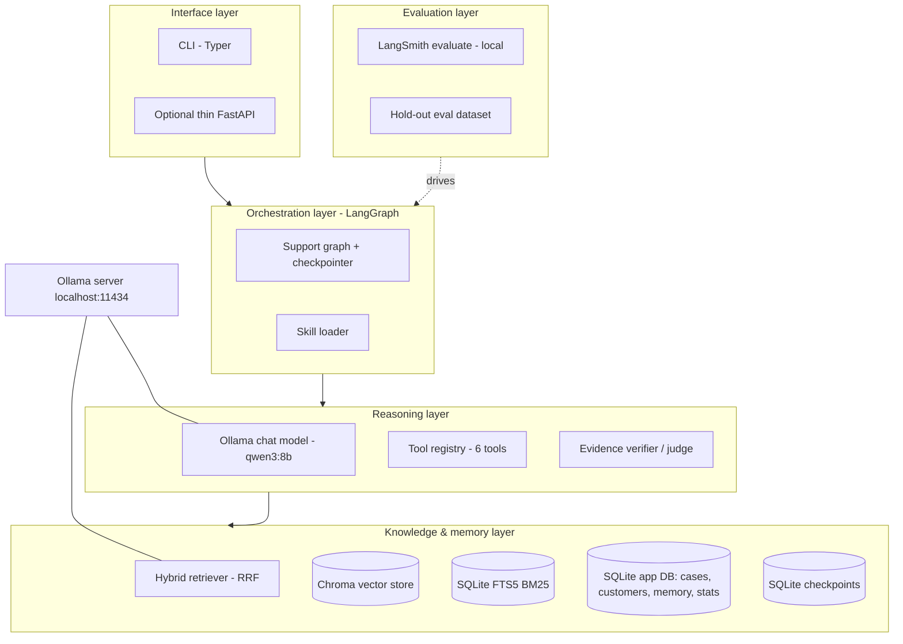
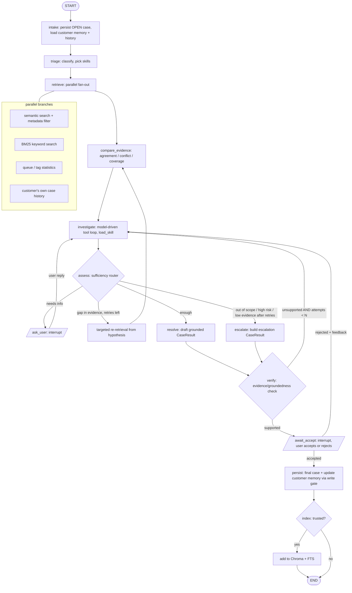
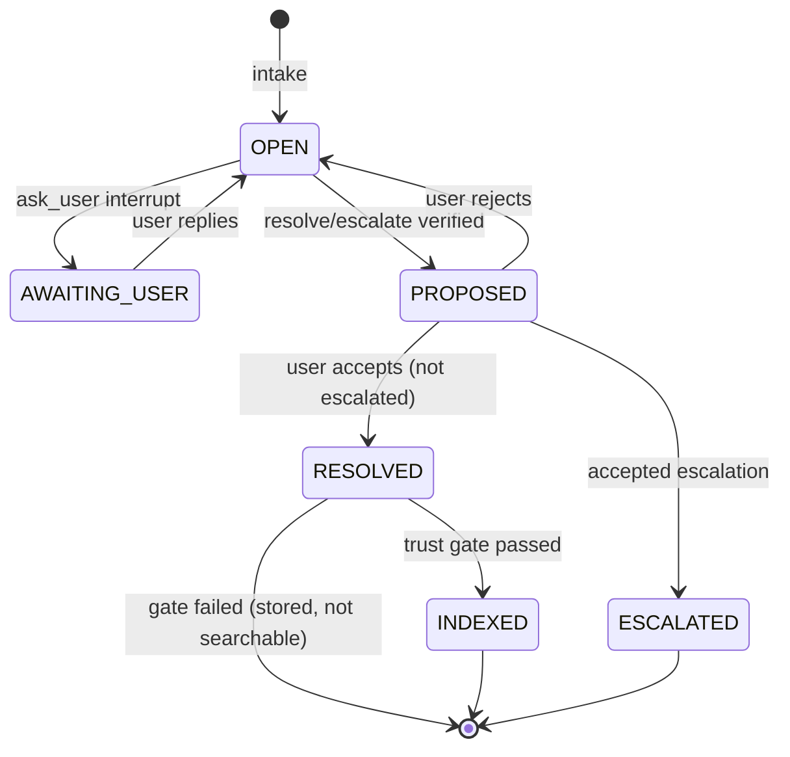
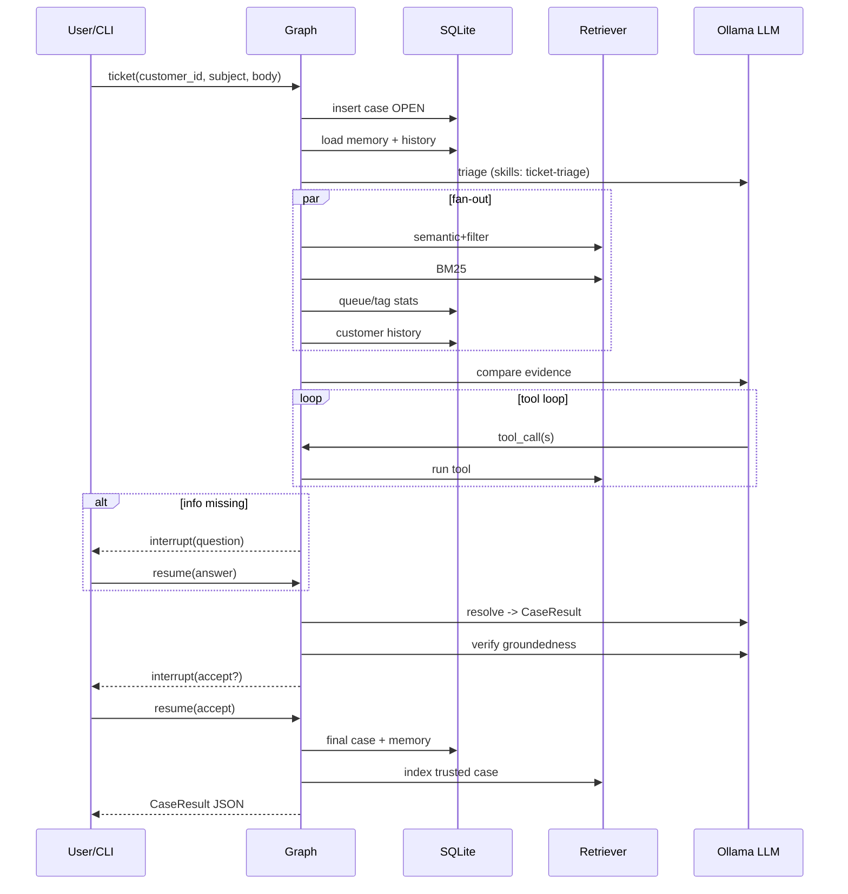

# Autonomous Support Investigation Agent — System Plan & Design

Status: **PLAN ONLY — awaiting approval before any code is written.**
Companion document: [`DECISIONS.md`](DECISIONS.md) (every technology choice, options considered, reasons).

---

## 1. Project analysis

### 1.1 What the assessment asks for (from the PDF)

| # | Requirement | How this plan satisfies it |
|---|---|---|
| A | LangGraph orchestration: many nodes, conditional routing, ≥1 loop/retry, interrupt/resume | 12-node graph, 4 conditional routers, 2 loops (investigate↔ask-user, verify→re-investigate), `interrupt()` + SQLite checkpointer (§3.3) |
| B | Case-based RAG over ~28K English tickets, metadata-aware, compare evidence across cases, targeted follow-up retrieval | Hybrid (vector + BM25) retrieval with metadata filters, RRF fusion, a dedicated **evidence-comparison** step that detects conflict / insufficiency, hypothesis-driven re-retrieval (§3.5) |
| C | Short-term memory (per thread) + long-term memory (per customer) | LangGraph checkpointer = short-term; SQLite `customer_memory` with a **write-worthiness gate** = long-term (§3.6) |
| D | ≥4 tools chosen by the model; ≥3 reusable skills loaded dynamically | 6 tools + 5 skills, skill catalogue (names+1-line) in prompt, full skill body loaded on demand via `load_skill` (§3.7) |
| E | Evaluation with LangSmith evaluators + eval datasets | `langsmith.evaluate` with local examples + custom/`openevals` evaluators, judge = local Ollama model, **no cloud upload required** (§5.5) |
| §3 | Every new query stored as open case; on final acceptance classification+resolution stored and indexed; open cases = customer history | `cases` table (status machine) + `index_case` node that adds trusted cases to the vector store (§3.4, §3.8) |
| §5 | Structured output: classification, evidence, analysis, resolution, escalation, confidence | `CaseResult` Pydantic model (§3.9) |
| §6 | Local, Python+LangGraph, only dataset as knowledge, secrets outside VCS | Fully local stack, `.env` gitignored, no external docs/web access |
| §7 | Ingest script, README, demo of 4 paths | `scripts/ingest.py`, README, `scripts/demo.py` with 4 scripted scenarios |

### 1.2 Your additional constraint
> POC → **no paid or API-based services.**

Everything (LLM, embeddings, vector DB, SQL DB, tracing, evaluation) runs on this machine. The PDF permits cloud LLMs but does not require one; we use **Ollama** only. No account or API key is required anywhere in the baseline setup.

### 1.3 Dataset facts that shape the design
Source: `Tobi-Bueck/customer-support-tickets` (Hugging Face).
- Columns: `subject, body, answer, type, queue, priority, language, version, tag_1…tag_8` (tags sparse; ~52 queues, 4 types, 5 priority values on the card).
- **No ticket ID** → we assign a stable ID at ingest (`H-000001…`).
- **No customer ID** → customer identity is supplied by the caller for *new* tickets (`--customer-id`). Historical rows have no customer, so “customer history” and “long-term memory” only ever refer to tickets created through our agent. (Called out in README limitations.)
- Dataset mixes English and German; we filter `language == "en"` (~28K).
- `answer` is agent-authored/synthetic and may be generic or inconsistent → the agent must *compare* answers rather than copy one (matches requirement B).
- Inputs may contain `<name>`-style placeholders; we normalise but do not rely on PII.

### 1.4 Key risks and mitigations
| Risk | Mitigation |
|---|---|
| Small local LLMs are weak at tool calling / JSON | Use a tool-capable model (`qwen3:8b`, fallback `gpt-oss:20b`), Pydantic structured output with retry-and-repair, temperature 0, bounded tool-loop (max 5 steps) |
| Embedding 28K rows locally is slow | `nomic-embed-text` via Ollama batch `/api/embed`; one-time ingest (~10–20 min est.), resumable and idempotent |
| Eval leakage (testing on indexed tickets) | Hold out ~200 tickets from the index; evals use only the hold-out |
| Self-poisoning knowledge (bad LLM answers indexed) | Trust gate: only user-accepted + evidence-verified + confidence ≥ 0.7 + not escalated cases are indexed; tagged `source=live` |
| Python 3.14 wheel gaps (chromadb etc.) | Pin **Python 3.12** via `uv` |
| Local inference latency | Parallel retrieval fan-out, small `num_ctx`, cap on retrieved context, `--fast` demo flag |

---

## 2. Agentic pattern selected

**Plan-free ReAct investigator wrapped in an evaluator–optimizer (reflection) loop, with human-in-the-loop clarification.**

- *Why not a single ReAct agent:* needs deterministic guarantees on persistence, memory write gating, and the final verify step; those belong in graph nodes, not in the model's discretion.
- *Why not plan-and-execute:* investigation path depends on what retrieval returns (conflicts, gaps), so a fixed plan is wasteful.
- The model decides **which tools to call and when** inside the `investigate` node (satisfies “not a hard-coded sequence”); the graph decides **control flow around it** (sufficiency → ask/escalate/resolve, verify → loop).
Full comparison in `DECISIONS.md` §D1.

---

## 3. System architecture

### 3.1 Layered view



### 3.2 Components

| Component | Module (planned path) | Responsibility |
|---|---|---|
| CLI | `src/support_agent/cli.py` | `ingest`, `ticket`, `resume`, `show`, `demo`, `eval` commands |
| Config | `src/support_agent/config.py` | pydantic-settings; env/`.env`; model names, thresholds, paths |
| Graph | `graph/builder.py`, `graph/nodes/*.py`, `graph/routing.py`, `graph/state.py` | Topology, nodes, routers, state schema |
| LLM adapter | `llm.py` | `ChatOllama` (tools, structured output), retry/repair helper |
| Retrieval | `retrieval/hybrid.py`, `retrieval/embeddings.py`, `retrieval/compare.py` | Vector+BM25+filters, RRF, evidence comparison |
| Tools | `tools/*.py` | 6 tools, each with Pydantic arg schema |
| Skills | `skills/*/SKILL.md`, `skills/loader.py` | Markdown+frontmatter instruction modules |
| Memory | `memory/short_term.py`, `memory/long_term.py` | Checkpointer wiring; customer memory read/write + gate |
| Storage | `storage/db.py`, `storage/schema.sql`, `storage/cases.py` | SQLite access, migrations |
| Ingestion | `ingest/loader.py`, `ingest/clean.py`, `scripts/ingest.py` | Download, filter, clean, split hold-out, index |
| Evaluation | `evals/dataset.py`, `evals/evaluators.py`, `evals/run.py` | LangSmith-API evaluators run locally |
| Schemas | `schemas.py` | `CaseResult`, `Classification`, `EvidenceItem`, etc. |

### 3.3 Graph topology



**Control-flow summary**
- **Routers (4):** `assess` (4 outcomes), `verify` (2), `await_accept` (2), `index` (2).
- **Loops:** (1) `investigate → assess → ask_user → investigate` (clarification), (2) `assess → retrieve_followup → compare` (hypothesis-driven retrieval), (3) `verify → investigate` (unsupported answer), (4) `await_accept → investigate` (user rejection). All bounded by `max_investigation_rounds=3`, `max_verify_retries=2`.
- **Interrupts:** `ask_user` and `await_accept` call `langgraph.types.interrupt(...)`; resume with `Command(resume=...)` using the same `thread_id`. State survives process restarts via SQLite checkpointer.
- **Parallelism:** `retrieve` fans out to 4 independent branches (reducer-merged into state) — satisfies the “parallel execution” bonus.
- **Non-interactive mode:** `--auto-accept` flag skips `await_accept` for batch eval.

### 3.4 Case lifecycle


OPEN/AWAITING cases are visible to `get_customer_history` (the PDF's “new/open cases are customer history”) but **not** to the vector index of trusted knowledge.

### 3.5 RAG design
1. **Document unit:** one ticket = one document. Text for embedding: `Subject: … \n Body: …` (answer *not* embedded to avoid answer-biased matches; stored as payload and shown after retrieval). A second, optional vector on `answer` is out of POC scope.
2. **Metadata:** `ticket_id, queue, type, priority, tags[], source (hist|live), trusted`.
3. **Retrieval:** semantic top-30 (Chroma, optional `where` filter on predicted queue/type) + BM25 top-30 (SQLite FTS5 on subject+body+tags) → **Reciprocal Rank Fusion** → top-8. If the filtered search returns < 3 hits, it relaxes the filter (logged).
4. **Compare-evidence step** (`retrieval/compare.py`): groups top-k by queue/type, clusters answers (embedding similarity of `answer`), and emits `EvidenceAssessment { agreement: high|mixed|low, conflicts[], coverage_gaps[], supporting_ids[] }`. The LLM writes the conflict explanation; the stats are computed deterministically.
5. **Follow-up retrieval:** after the investigator states a hypothesis (“looks like SSO misconfiguration”), `retrieve_followup` issues a targeted query + filters derived from the hypothesis.
6. **Live knowledge:** newly indexed cases get `source=live`; scoring gives them no boost, but the output marks them so the demo can show “retrieval of a newly resolved case”.

### 3.6 Memory design
| | Short-term | Long-term |
|---|---|---|
| Scope | One `thread_id` (one ticket conversation) | One `customer_id`, across threads |
| Storage | LangGraph `SqliteSaver` checkpoints + `messages` in state | SQLite `customer_memory` table (+ `cases` for history) |
| Content | Messages, retrieved evidence, hypothesis, tool results, clarification Q&A | Stable facts only (see gate) |
| Written | Automatically each super-step | Only in `persist`, after acceptance |

**Write-worthiness gate** (an LLM extraction restricted to a fixed schema + deterministic filter):
- **Store:** product/environment facts the customer stated (e.g. “uses on-prem Okta SSO”), recurring issue patterns, preferences that affect handling (language/tone/contact preference), unresolved caveats, past accepted resolution summary (1 line).
- **Do not store:** the raw ticket text, greetings, one-off transient details, anything already derivable from `cases`, or sensitive tokens/credentials/emails/phone numbers (regex scrub).
- Each memory item has `kind, text, source_case_id, confidence, created_at, last_used_at`; duplicates merged by embedding/lexical similarity; capped per customer (e.g., 30, LRU by `last_used_at`).
- Loaded in `intake` (top-N relevant by lexical match to the new ticket) and injected as a compact “Customer context” block.

### 3.7 Tools and skills
**Tools (model-selected, bound via `bind_tools`; executed by `ToolNode`):**
| Tool | Purpose | Backing store |
|---|---|---|
| `search_similar_tickets(query, queue?, type?, priority?, tags?, k)` | Hybrid retrieval of historical/live cases | Chroma + FTS5 |
| `get_ticket_by_id(ticket_id)` | Full record of a case (hist or live) | SQLite |
| `get_customer_history(customer_id, limit)` | Customer's open + past cases and memory | SQLite |
| `get_queue_tag_statistics(queue?, tag?, type?)` | Counts, priority mix, top tags, common resolution phrases | SQLite aggregate |
| `update_classification(queue, type, priority, tags, reason)` | Revises the open case's classification | SQLite |
| `escalate_ticket(reason, target_queue, severity)` | Records escalation request on the case | SQLite |
| `load_skill(name)` | Returns full instructions of a skill (meta-tool) | files |
| `ask_user` is **not** a tool; it is a graph interrupt triggered by the `assess` router (keeps HITL deterministic) |

**Skills (Markdown + YAML frontmatter, dynamic loading):**
1. `ticket-triage` — how to pick queue/type/priority/tags using evidence + stats.
2. `incident-investigation` — hypothesis → targeted retrieval → compare answers → conflict handling.
3. `clarification` — when and how to ask one focused question (what is missing, why).
4. `escalation` — criteria (low agreement, critical priority, security/billing risk, no evidence) and handoff format.
5. `customer-response` — tone, structure, grounded-citation style, no invented specifics.

Loading mechanism: the system prompt contains only a ~5-line skill catalogue (name + when-to-use). `triage` pre-selects 1–2 skills from the catalogue via a classifier call; the model may call `load_skill` for others. Only loaded skill bodies are appended to the prompt for that node.

### 3.8 Data flow (happy path)



### 3.9 State schema (TypedDict, with reducers)

```python
class AgentState(TypedDict):
    # identity
    case_id: str
    customer_id: str
    thread_id: str
    ticket: Ticket  # subject, body, channel, created_at
    # short-term / conversation
    messages: Annotated[list[AnyMessage], add_messages]
    clarifications: Annotated[list[QA], operator.add]
    # memory
    customer_memory: list[MemoryItem]
    customer_history: list[CaseSummary]
    # triage
    classification: Classification | None
    selected_skills: list[str]
    # evidence
    evidence: Annotated[list[EvidenceItem], merge_by_id]  # reducer for parallel branches
    evidence_assessment: EvidenceAssessment | None
    hypothesis: str | None
    # control
    investigation_round: int
    verify_attempts: int
    pending_question: str | None
    route: Literal["resolve", "ask_user", "retrieve_more", "escalate"] | None
    verification: VerificationReport | None
    user_accepted: bool | None
    # output
    result: CaseResult | None
```

`CaseResult` (final output, matches PDF §5):
```json
{
  "case_id": "C-2026-000123",
  "classification": {"queue": "Technical Support", "type": "Incident", "priority": "high", "tags": ["VPN","Login"]},
  "evidence": [{"ticket_id":"H-004211","queue":"Technical Support","similarity":0.82,"summary":"…","source":"hist"}],
  "analysis": "Concise reasoning, conflicts noted…",
  "resolution": "Recommended response/action…",
  "escalation": {"required": false, "reason": null, "target_queue": null},
  "confidence": 0.78,
  "verification": {"grounded": true, "unsupported_claims": []}
}
```
Confidence = weighted blend: evidence agreement (0.4), retrieval score mass (0.2), verifier grounding score (0.3), classification certainty (0.1) — computed deterministically, not “asked of the LLM”.

### 3.10 Technology stack (summary; rationale in DECISIONS.md)
| Concern | Choice |
|---|---|
| Language/runtime | Python 3.12 managed by `uv` |
| Orchestration | LangGraph 1.2.x + `langgraph-checkpoint-sqlite` |
| LLM (local) | Ollama; `qwen3:8b` primary, `gpt-oss:20b` (already installed) fallback |
| Embeddings (local) | Ollama `nomic-embed-text` |
| Vector DB | ChromaDB (persistent, local) |
| Keyword search | SQLite FTS5 (BM25) |
| Structured DB | SQLite (WAL mode) |
| Schemas/validation | Pydantic v2 |
| CLI | Typer |
| API (optional) | FastAPI bound to 127.0.0.1 |
| Eval | `langsmith` (local `evaluate`), `openevals` helpers, judge = Ollama |
| Quality | pytest, ruff, mypy, pre-commit |

---

## 4. Design documentation

### 4.1 Database schema (SQLite — `data/app.db`)

```sql
-- Historical corpus (immutable) + live trusted cases share one table for lookup by ID
CREATE TABLE tickets (
  ticket_id   TEXT PRIMARY KEY,           -- 'H-000001' (historical) | case_id for live
  source      TEXT NOT NULL CHECK (source IN ('hist','live')),
  subject     TEXT, body TEXT, answer TEXT,
  queue TEXT, type TEXT, priority TEXT, language TEXT,
  tags_json   TEXT,                       -- JSON array
  holdout     INTEGER DEFAULT 0,          -- 1 = excluded from index (eval set)
  created_at  TEXT DEFAULT CURRENT_TIMESTAMP
);
CREATE INDEX idx_tickets_queue ON tickets(queue, type, priority);
CREATE VIRTUAL TABLE tickets_fts USING fts5(subject, body, tags, content='');   -- BM25

-- Cases created by the agent
CREATE TABLE cases (
  case_id TEXT PRIMARY KEY, customer_id TEXT NOT NULL, thread_id TEXT NOT NULL,
  status TEXT NOT NULL CHECK (status IN ('OPEN','AWAITING_USER','PROPOSED','RESOLVED','ESCALATED','INDEXED')),
  subject TEXT, body TEXT,
  queue TEXT, type TEXT, priority TEXT, tags_json TEXT,
  resolution TEXT, analysis TEXT, confidence REAL,
  escalation_required INTEGER DEFAULT 0, escalation_reason TEXT,
  evidence_json TEXT, accepted INTEGER, indexed INTEGER DEFAULT 0,
  created_at TEXT, updated_at TEXT
);
CREATE INDEX idx_cases_customer ON cases(customer_id, created_at);

CREATE TABLE case_events (             -- audit trail / tool-usage trace
  id INTEGER PRIMARY KEY, case_id TEXT, ts TEXT, kind TEXT, payload_json TEXT
);

CREATE TABLE customers (customer_id TEXT PRIMARY KEY, display_name TEXT, created_at TEXT);

CREATE TABLE customer_memory (
  id INTEGER PRIMARY KEY, customer_id TEXT NOT NULL,
  kind TEXT CHECK (kind IN ('environment','pattern','preference','caveat','outcome')),
  text TEXT NOT NULL, source_case_id TEXT, confidence REAL,
  created_at TEXT, last_used_at TEXT,
  UNIQUE(customer_id, text)
);
```
LangGraph checkpoint tables live in `data/checkpoints.db` (managed by the library). Chroma lives in `data/chroma/` (collection `tickets`, cosine).

### 4.2 Interface specification

**CLI (primary)**
```
agent ingest   [--limit N] [--holdout 200] [--rebuild]
agent ticket   --customer-id C1 --subject "…" --body "…" [--thread-id T] [--auto-accept]
agent resume   --thread-id T --answer "…"            # answers an interrupt (clarification or accept/reject)
agent show     --case-id C-… | --customer-id C1
agent demo     [--scenario normal|clarify|memory|growth|all]
agent eval     [--limit N] [--judge qwen3:8b]
```
**Optional REST API** (FastAPI, `127.0.0.1:8000`, only if time permits; same graph underneath)
| Method | Path | Body → Response |
|---|---|---|
| POST | `/tickets` | `{customer_id, subject, body}` → `{thread_id, case_id, status, interrupt?}` |
| POST | `/threads/{id}/resume` | `{answer}` → same envelope |
| GET | `/cases/{case_id}` | → `CaseResult` + status |
| GET | `/customers/{id}/history` | → case summaries + memory |
| GET | `/health` | → Ollama/Chroma/DB status |

### 4.3 UI / UX
Frontend explicitly not required. CLI uses `rich` for readable output; clarification prompt example:
```
╭─ Agent needs more information (case C-2026-000124) ─────────────────╮
│ Is the login failure on all devices or only the new laptop?         │
╰──────────────────────────────────────────────────────────────────────╯
 Reply with:  agent resume --thread-id T-91f --answer "…"
```

### 4.4 Repository layout
```
DCKAP/
├─ docs/ (PLAN.md, DECISIONS.md, ARCHITECTURE.md later)
├─ src/support_agent/…           (modules listed in §3.2)
├─ skills/*/SKILL.md
├─ scripts/ingest.py, scripts/demo.py
├─ tests/{unit,integration,e2e}/
├─ evals/datasets/*.jsonl
├─ data/            (gitignored)
├─ pyproject.toml, uv.lock, .env.example, .gitignore, Makefile, README.md
└─ .github/workflows/ci.yml
```

---

## 5. Implementation plan

### 5.1 Phases, milestones, estimates (1 engineer, ~6 working days)
| Phase | Deliverable | Depends on | Est. |
|---|---|---|---|
| P0 Setup | Repo, `uv` env (py3.12), Ollama models pulled, config, CI skeleton | — | 0.5 d |
| P1 Data & ingestion | Loader, cleaning, hold-out split, SQLite+FTS, Chroma embed/index script (resumable) | P0 | 1 d |
| P2 Retrieval core | Hybrid retriever, RRF, filters, compare-evidence, retrieval tests | P1 | 1 d |
| P3 Tools & skills | 6 tools + loader + 5 SKILL.md | P2 | 0.75 d |
| P4 Graph | State, nodes, routers, interrupts, checkpointer, parallel fan-out | P3 | 1.5 d |
| P5 Memory & growth | Case lifecycle, memory gate, index-on-accept | P4 | 0.5 d |
| P6 Evaluation | Eval dataset, 5 evaluators, runner | P4,P5 | 0.75 d |
| P7 Demo & docs | 4 scripted scenarios, README, ARCHITECTURE | all | 0.5 d |
| Buffer | prompt tuning for local model | — | 0.5 d |

**Critical path:** P0→P1→P2→P3→P4→P5→P7. P6 can start once P4 skeleton runs (parallelisable on a team of 2).

### 5.2 Task breakdown (selected)
- P1: download parquet/CSV → filter `en` → normalise whitespace/placeholders → merge `tag_1..8` → assign IDs → hold-out 200 stratified by queue → insert SQLite → batch-embed (size 64) → Chroma upsert with checkpoint file.
- P3: each tool = Pydantic args + docstring (drives model tool selection) + unit tests.
- P4: build graph incrementally — linear skeleton first, then routers, then interrupts, then fan-out.

### 5.3 Resource requirements
- Hardware (detected): Apple Silicon, 32 GB RAM → comfortable for 8B model; 20B (13 GB) works but slower.
- Software: Python 3.12, `uv`, Ollama 0.40.x (installed), models: `qwen3:8b` (~5 GB, to pull), `nomic-embed-text` (~270 MB, to pull). `gpt-oss:20b`, `mistral`, `llama3` already present.
- Disk: ~3 GB for models, ~1 GB data/indexes.
- Cost: **$0**. Internet only for one-time dataset download and model pulls.

### 5.4 Risks to schedule
Local-model prompt tuning is the main unknown (buffer included). If `qwen3:8b` is unreliable at tool calling, switch to `gpt-oss:20b` through a single config value.

### 5.5 Evaluation design (LangSmith evaluators, local)
- **Dataset:** ~40 examples: 30 from hold-out tickets (input = ticket, reference = historical answer/queue) + 10 hand-written behaviour cases (ambiguous ticket → must ask; unsupported domain → must escalate; repeat customer → must use memory).
- **Runner:** `langsmith.evaluate(target, data=<local examples>, evaluators=[…], upload_results=False)` → no LangSmith account required. Optional: set `LANGSMITH_TRACING=true` + free-tier key later (not needed, not committed). *(API behaviour of `upload_results=False` to be verified against installed version at implementation time.)*
- **Evaluators:**
  | Evaluator | Type | Measures |
  |---|---|---|
  | `retrieval_relevance` | code | Hit@k of reference queue/type among retrieved evidence; mean similarity |
  | `groundedness` | LLM-judge (Ollama) | Each resolution claim supported by cited evidence |
  | `response_quality` | LLM-judge + embedding cosine vs reference answer | Helpfulness/correctness |
  | `tool_usage` | code (trajectory from `case_events`) | Used ≥1 retrieval tool, no redundant repeats, `escalate_ticket` only when `escalation.required` |
  | `behaviour` | code | Clarification asked iff dataset says ambiguous; loop bounds respected; schema valid |
- Reported as a markdown table by `agent eval`.

---

## 6. Testing strategy

| Level | Scope | Approach |
|---|---|---|
| Unit | cleaning, RRF, compare-evidence stats, memory gate/scrubber, confidence formula, skill loader, each tool, routers | pytest; pure functions; fake retriever/DB fixtures (tmp SQLite, in-memory Chroma) |
| LLM-boundary unit | structured-output repair, prompt builders | `FakeListChatModel`/stub LLM returning canned tool calls — deterministic |
| Integration | retriever↔Chroma↔FTS on a 500-row fixture; graph with stub LLM through every route (resolve, ask+resume, retrieve_more, escalate, verify-loop, reject-loop); checkpoint resume after process restart | pytest; marker `integration` |
| System / E2E | Full graph with real Ollama on 4 demo scenarios | marker `e2e` (opt-in, slow); asserts only structure/invariants (case persisted, result schema valid, indexed after accept), not exact wording |
| Evaluation | Agent quality | `agent eval` (§5.5), tracked over time in `evals/results/*.json` |
| QA | ruff, mypy (strict on core), coverage ≥ 80 % on non-LLM code, secret scan (`gitleaks`), dependency audit (`pip-audit`) | pre-commit + CI |

**Demo acceptance (maps to PDF §7):**
1. *Normal resolution* — clear VPN/login ticket → grounded resolution, confidence ≥ 0.7.
2. *Clarification + resume* — vague “can't access it” → interrupt → `resume` with answer → resolution.
3. *Long-term memory reuse* — same customer, second ticket; output shows recalled environment fact without re-asking.
4. *Growth* — after accepting a case in (1), a similar new ticket retrieves it as `source=live` evidence.

---

## 7. Deployment & DevOps (POC-appropriate)

- **Deployment:** local only. `make setup && make ingest && make demo`. No cloud, no containers required.
- **Optional container:** Dockerfile from `registry.redhat.io/ubi9/python-312-minimal`, non-root user, API bound to `127.0.0.1`, Ollama reached at `host.docker.internal`/localhost (per security policy: no `0.0.0.0` bindings, minimal Red Hat base).
- **Environments:** `dev` (default; `data/`), `test` (tmp dirs, stub LLM), optional `eval` (hold-out, temp copy of DB so the eval does not pollute live knowledge).
- **Configuration & secrets:** `.env.example` committed; `.env` and `data/` in `.gitignore`. No secrets needed in baseline; optional `LANGSMITH_API_KEY` only via env.
- **CI (GitHub Actions, free):** lint (ruff) → type check (mypy) → unit+integration tests with stub LLM → `pip-audit` → gitleaks. E2E/eval jobs are manual because they need Ollama.
- **Git workflow:** `main` protected; feature branches per phase (`feat/ingest`, `feat/graph`, …); Conventional Commits; one commit per logical unit; tag `v0.1.0-poc`.
- **Observability:** structured JSON logs (no ticket bodies at INFO, per security rules), `case_events` audit table, optional local LangGraph Studio / tracing disabled by default.

---

## 8. LLM integration with Ollama

### 8.1 Setup
```bash
brew install ollama            # already installed (v0.40.16)
ollama serve                   # listens on 127.0.0.1:11434 (do NOT bind to 0.0.0.0)
ollama pull qwen3:8b           # chat + tool calling
ollama pull nomic-embed-text   # embeddings
# fallbacks already installed: gpt-oss:20b, mistral, llama3
uv venv --python 3.12 && uv sync
```
`.env.example`:
```
OLLAMA_BASE_URL=http://127.0.0.1:11434
CHAT_MODEL=qwen3:8b
EMBED_MODEL=nomic-embed-text
JUDGE_MODEL=qwen3:8b
MAX_INVESTIGATION_ROUNDS=3
TRUST_CONFIDENCE_THRESHOLD=0.7
```

### 8.2 Endpoints used
| Endpoint | Use |
|---|---|
| `POST /api/chat` (via `langchain-ollama` `ChatOllama`) | Chat, tool calling (`tools`), JSON-schema structured output (`format`) |
| `POST /api/embed` | Batch embeddings (ingest + query) |
| `GET /api/tags` | Health check at startup (models present?) |

### 8.3 Implementation patterns
- **Tool calling:** `ChatOllama(model, temperature=0, num_ctx=8192).bind_tools(TOOLS)`; loop capped at 5 tool steps per `investigate` call; unknown/invalid tool args → error message returned to the model once, then abort to `assess`.
- **Structured output:** `llm.with_structured_output(Model, method="json_schema")`; wrapper retries once with a “repair” message on validation failure.
- **Per-node model roles:** cheap deterministic prompts for `triage`, `compare`, `verify`; tool-enabled for `investigate`; same model by default, overridable per role.
- **Context budgeting:** each evidence item truncated to ~600 chars; max 8 items; loaded skill bodies < 400 tokens each.
- **Thinking models:** for qwen3, disable/strip `<think>` blocks in structured steps (`think=False` where supported) to keep JSON clean.
- **Determinism:** temperature 0, fixed seed in eval mode.
- **Embedding hygiene:** `search_document:` / `search_query:` prefixes for nomic; same normaliser for ingest and query.
- **Failure handling:** Ollama unreachable → clear CLI error; node-level timeouts (120 s).

---

## 9. Security & compliance notes (per project security rules)
- All services bound to `127.0.0.1`; TLS not applicable on loopback; any external call (dataset/model download) is HTTPS.
- No hardcoded secrets; `.gitignore` created first; gitleaks in CI.
- Dependencies pinned in `uv.lock`; all chosen packages actively maintained (latest at time of check: langgraph 1.2.22, langchain-ollama 1.1.0, chromadb 1.5.9, langsmith 0.15.0, langgraph-checkpoint-sqlite 3.1.3, pydantic 2.14.3, typer 0.29.2) — versions re-verified at install; `pip-audit` gate.
- SQL via parameterised queries only; FTS query input sanitised; CLI input length-validated.
- Logs omit PII/ticket bodies; memory writes scrub emails/phones/tokens.
- Errors shown to users are generic; details only in local logs.

---

## 10. Decisions taken on the open questions
1. **Chat model:** `qwen3:8b` (fallback `gpt-oss:20b`), see `DECISIONS.md`.
2. **Customer ID:** supplied via `--customer-id` (the dataset has none).
3. **Acceptance step:** interactive accept/reject via interrupt, with `--auto-accept` for batch/eval.
4. **API layer:** CLI only (no FastAPI) for the POC.
5. **Repo:** plain git repository; no hosted CI is required to run the project.
